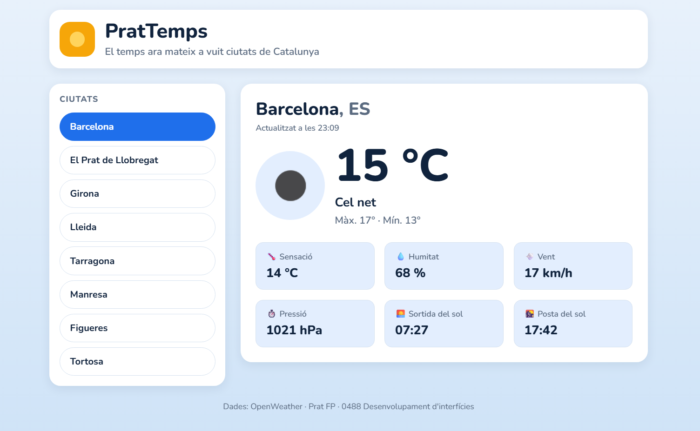

# PratTemps

PratTemps és una web petita que mostra el temps que fa ara mateix a la ciutat que
l'usuari tria d'una llista de vuit ciutats de Catalunya (Barcelona, El Prat de
Llobregat, Girona, Lleida, Tarragona, Manresa, Figueres i Tortosa). Les dades
vénen de l'API Current Weather d'OpenWeather.

Fet amb Vite + React 19 + TypeScript i CSS Modules.

## Captura



## Com executar-la

1. Clona el repositori:
   ```bash
   git clone https://github.com/EL-TEU-USUARI/prattemps.git
   cd prattemps
   ```
2. Instal·la les dependències:
   ```bash
   npm install
   ```
3. Copia `.env.example` a `.env` i posa-hi la teva clau d'OpenWeather:
   ```bash
   cp .env.example .env
   ```
   ```
   VITE_OWM_KEY=la_teva_clau
   ```
   Si no hi ha clau, la web mostra l'avís «Falta la clau d'OpenWeather».
4. Arrenca el servidor de desenvolupament:
   ```bash
   npm run dev
   ```

## Estructura

```
src/
├── components/   # Components (cada un amb el seu CSS Module)
├── config/       # claus.ts: lectura de la clau amb import.meta.env
├── dades/        # ciutats.ts: les vuit ciutats
├── hooks/        # useApi<T>: hook propi per fer peticions
├── utils/        # missatgeError, urlTemps i funcions de format
├── tipus.ts      # tipus Temps (resposta de l'API)
└── index.css     # tokens de disseny
```

## Eines d'interfície natural

| Eina | Què fa | Com es podria fer servir a PratTemps |
|------|--------|--------------------------------------|
| Web Speech API | Permet que el navegador reconegui la veu (SpeechRecognition) i que llegeixi textos en veu alta (SpeechSynthesis). | Dir «temps a Girona» per triar la ciutat sense tocar la pantalla, i que la web llegeixi en veu alta la temperatura i la descripció. |
| TensorFlow.js | Executa models d'aprenentatge automàtic directament al navegador, sense enviar dades a cap servidor. | Entrenar un model petit que, a partir de la temperatura, el vent i la humitat, suggereixi quina roba posar-se o si convé agafar paraigua. |
| MediaPipe | Detecta mans, cara o postura a partir de la càmera web, en temps real. | Canviar de ciutat amb gestos de la mà (lliscar a dreta o esquerra) sense fer servir ratolí ni teclat. |
| ml5.js | Llibreria senzilla basada en TensorFlow.js amb models ja preparats (classificar imatges, reconèixer so…). | Reconèixer amb la càmera una foto del cel i comparar-la amb la descripció que dona OpenWeather. |
